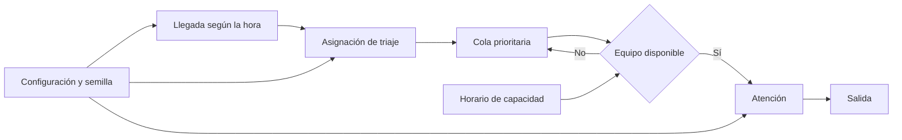

# Parte 3. Formulación del modelo y simulación

## 1. Diagrama del sistema



La llegada genera un paciente y su prioridad. El paciente solicita un equipo de
atención en una cola ordenada primero por nivel de triaje y luego por orden de
llegada. El horario determina cuántas atenciones pueden ejecutarse simultáneamente.

## 2. Variables y parámetros

| Símbolo/campo | Tipo | Unidad | Descripción | Procedencia actual |
|---|---|---|---|---|
| `arrival_rates[h]` | Parámetro | pacientes/hora | Tasa de llegada de la hora `h` | Estimada; será calibrada con `ARRTIME` |
| `triage_probabilities[k]` | Parámetro | proporción | Probabilidad del nivel `k` | Estimada; será calibrada con `IMMEDR` |
| `service_medians_minutes[k]` | Parámetro | minutos | Mediana de ocupación por triaje | Estimada; será calibrada y declarada como abstracción |
| `capacity_schedule[b]` | Decisión | equipos | Equipos del bloque `b` | Escenario definido por el usuario |
| `queue_length(t)` | Estado | pacientes | Pacientes medidos esperando | Resultado interno |
| `busy_teams(t)` | Estado | equipos | Equipos atendiendo pacientes | Resultado interno |
| `wait_minutes` | Salida | minutos | Inicio de servicio menos llegada | Calculada por paciente |
| `resource_utilization` | Salida | proporción | Minutos ocupados/capacidad disponible | Calculada |

## 3. Llegadas

Dentro de cada hora se supone una tasa constante. Para una tasa
\(\lambda_h>0\), el tiempo entre llegadas es:

$$
T_h=-\frac{\ln(U)}{\lambda_h},\qquad U\sim\mathrm{Uniforme}(0,1).
$$

Si el tiempo generado cruza la siguiente hora, se avanza hasta la frontera y se
vuelve a muestrear con la nueva tasa. Así se evita utilizar una tasa anterior
fuera de su intervalo.

## 4. Prioridad

Los niveles van de 1 a 5, donde 1 representa la mayor urgencia. SimPy ordena las
solicitudes mediante `PriorityResource`; un número menor tiene precedencia. Entre
pacientes con igual prioridad se conserva el orden de solicitud.

El modelo no interrumpe una atención en curso cuando llega un paciente más urgente.
La prioridad actúa únicamente entre pacientes en espera.

## 5. Duración del servicio

La versión funcional utiliza una lognormal por nivel de triaje:

$$
S_k\sim\mathrm{Lognormal}(\ln(m_k),\sigma),
$$

donde \(m_k\) es la mediana configurada. Los valores se limitan a un intervalo
positivo para evitar duraciones numéricamente extremas. Estos parámetros están
etiquetados como estimados hasta completar la calibración.

## 6. Capacidad variable

El recurso se crea con la capacidad máxima diaria. Procesos controladores reservan
los espacios no disponibles en cada bloque. Cuando la capacidad disminuye, una
atención en curso termina normalmente; el espacio se bloquea después de liberarse.
Esta regla evita expulsar pacientes del servicio.

## 7. Calentamiento y censura

Por defecto se simulan dos días:

- día 1: calentamiento para evitar una cola inicialmente vacía;
- día 2: ventana de medición.

Los pacientes del calentamiento afectan la congestión, pero no se contabilizan
como observaciones. Al terminar el horizonte se informan explícitamente pacientes
sin iniciar y pacientes dentro del sistema; no se inventan tiempos para registros
censurados.

## 8. Pseudocódigo

```text
crear reloj, recurso prioritario y generador aleatorio con semilla
crear controladores para habilitar o bloquear cada equipo por horario

mientras el reloj sea menor que el horizonte:
    consultar tasa de la hora actual
    generar siguiente tiempo entre llegadas
    si cruza la hora, avanzar a la frontera y volver a generar
    crear paciente con triaje y duración
    solicitar recurso con prioridad de triaje
    registrar espera cuando el recurso sea adquirido
    mantener recurso durante la duración del servicio
    liberar recurso y registrar salida

cerrar integrales de cola
calcular métricas y comprobar conservación de pacientes
```

## 9. Separación de responsabilidades

- `config.py`: parámetros y validaciones.
- `simulation.py`: procesos y métricas del modelo.
- `cli.py`: ejecución reproducible sin interfaz.
- `app.py`: visualización e interacción; no contiene reglas del modelo.
- `tests/`: propiedades internas y reproducibilidad.

## 10. Reproducción desde un entorno limpio

```powershell
python -m venv .venv
.\.venv\Scripts\Activate.ps1
python -m pip install --upgrade pip
python -m pip install -e ".[dev]"
pytest
python -m ed_simulation.cli --seed 2026 --summary-only
streamlit run app.py
```

La CLI imprime métricas en JSON. Con `--output` puede guardar configuración,
semilla, métricas y trazas para auditoría.

## 11. Propiedades verificadas

- Misma configuración y semilla producen exactamente el mismo resultado.
- Las tasas y probabilidades inválidas fallan antes de simular.
- No existen tiempos de espera negativos.
- Se cumple `llegadas = completados + pacientes dentro del sistema`.
- Sin llegadas, las métricas de espera y cola son cero.
