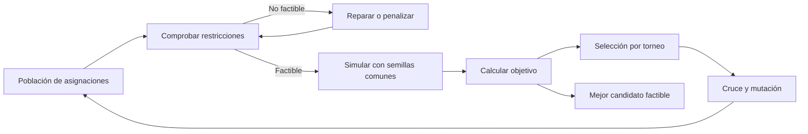

# Parte 4. Implementación de la mejora

## 1. Integración con la simulación



El optimizador no modifica el funcionamiento interno de la simulación. Cada
asignación crea nuevas configuraciones mediante `dataclasses.replace` y se evalúa
con el mismo modelo que la CLI y Streamlit.

## 2. Función objetivo

$$
J(x)=0.7\,\overline{W}(x)+0.3\,Q_{0.90}(W(x))+120\,C(x),
$$

donde:

- \(\overline{W}\): espera media de pacientes que iniciaron servicio;
- \(Q_{0.90}(W)\): percentil 90 de espera;
- \(C\): proporción que no inició atención al finalizar;
- 120: penalización en minutos por una unidad de proporción censurada.

El tercer término evita que el algoritmo reduzca las estadísticas observadas
dejando una parte de la cola sin iniciar servicio. En la fase experimental se
probará sensibilidad a este valor.

## 3. Restricciones formales

Para seis bloques de igual duración:

$$
\begin{aligned}
x_i &\in \mathbb{Z}, \\
x_{\min}\leq x_i &\leq x_{\max}, \\
\sum_{i=0}^{5}x_i &= \sum_{i=0}^{5}x_i^{\mathrm{base}}, \\
|x_{(i+1)\bmod 6}-x_i| &\leq \Delta_{\max}.
\end{aligned}
$$

La transición del último bloque al primero también se valida porque el horario se
repite diariamente.

## 4. Operadores implementados

### Inicialización

La población comienza con el escenario base y recorridos aleatorios por vecinos
factibles. Un vecino transfiere una unidad desde un bloque donante a otro receptor.

### Selección

Torneo de tres candidatos con regla de factibilidad:

1. una solución factible domina a una no factible;
2. entre factibles gana el menor objetivo;
3. entre no factibles gana la menor violación total.

### Cruce

El cruce uniforme escoge cada gen de uno de los progenitores. Después se ejecuta
una reparación que:

1. limita valores al rango permitido;
2. recupera el presupuesto total;
3. reduce violaciones de transición mediante transferencias;
4. vuelve a una alternativa factible conocida si no puede reparar.

### Mutación

Transfiere una unidad entre dos bloques y acepta únicamente vecinos factibles. La
suma permanece constante por construcción.

### Elitismo y terminación

Los dos mejores individuos pasan directamente a la siguiente generación. La
búsqueda termina por máximo de generaciones o por falta de mejora durante la
paciencia configurada.

## 5. Parámetros predeterminados

| Parámetro | Valor | Justificación inicial |
|---|---:|---|
| Población | 24 | Diversidad suficiente para seis genes con costo moderado |
| Generaciones | 20 | Límite reproducible para la primera versión |
| Réplicas por candidato | 3 | Reduce ruido durante desarrollo; la Parte 5 usará 30 o más por condición final |
| Cruce | 0.80 | Favorece recombinación de asignaciones |
| Mutación | 0.25 | Mantiene exploración sin destruir toda la estructura |
| Élites | 2 | Conserva alternativas con buen desempeño |
| Torneo | 3 | Presión selectiva moderada |
| Paciencia | 8 | Evita evaluaciones sin mejora |
| Penalización de censura | 120 min | Evita favorecer colas sin atender |

Estos valores son configurables desde código, CLI y Streamlit. No representan
todavía una afinación experimental.

## 6. Semillas y comparación justa

Todos los candidatos utilizan exactamente el mismo conjunto de semillas de
simulación. La semilla del algoritmo genético es independiente y controla
selección, cruce, mutación e inicialización. El resultado registra ambas clases de
semilla.

## 7. Comprobación por código

`constraint_violations()` devuelve violaciones separadas de longitud, límites,
presupuesto y suavidad. `is_feasible()` exige que todas sean cero. Antes de devolver
una solución, `optimize_staffing()` vuelve a comprobar que el mejor candidato sea
factible; de lo contrario genera un error.

Las pruebas automatizadas confirman:

- conservación del presupuesto;
- respeto a límites y transición diaria;
- reparación de candidatos;
- determinismo con las mismas semillas;
- factibilidad del resultado;
- objetivo final no peor que la alternativa base evaluada.

## 8. Ejecución

Búsqueda predeterminada:

```powershell
python -m ed_simulation.cli --optimize --summary-only
```

Búsqueda corta para demostración:

```powershell
python -m ed_simulation.cli --optimize --population 12 --generations 5 --replicates 2
```

Guardar evidencia:

```powershell
python -m ed_simulation.cli --optimize --output evidence/part4_candidate.json
```

## 9. Interpretación permitida

El resultado de esta parte es una **configuración candidata factible** sobre
parámetros estimados. Todavía no permite afirmar que un hospital real mejorará.
Las Partes 5 y 6 deben reevaluar la candidata con al menos 30 semillas
independientes, sensibilidad y datos reales de referencia.
